# Exomyth guide

A short tour of everything Exomyth can do, one topic at a time. The same guide opens inside the app:
press the **?** button at the bottom of the sidebar (or **Help** on the start screen). Pictures show
the demo world in the dark theme. [Русская версия](GUIDE.ru.md)

Every topic has a **Try it** button in the app that opens the right place in your world.

<!-- The app reads this file: each "##" section is a topic. The comment under a heading says which
     topic it is, which part of Settings it belongs to (feature) and what "Try it" does (try).
     Keep the order and the comments when editing; change the words freely. -->

## Getting started
<!-- guide: start -->

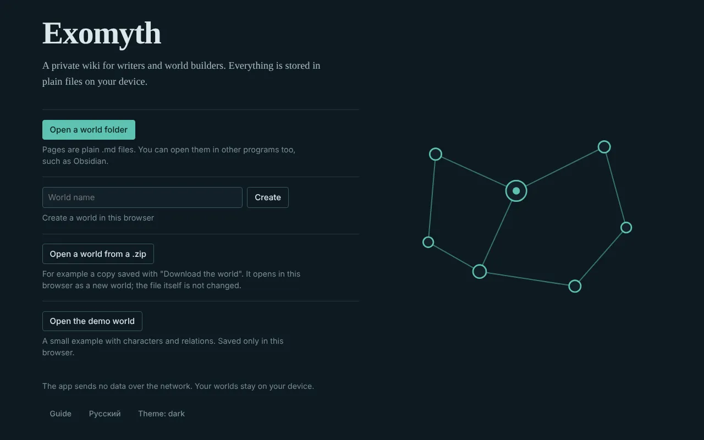

A **world** is a folder of plain Markdown pages: one story, one setting, one campaign. On the start
screen you can:

- **Open a folder** on your computer (Chrome, Edge and other browsers with folder access). Exomyth
  reads and writes the files there, and any other Markdown editor can open them too.
- **Create a world in the browser** where folders are not available (Firefox, Safari, phones). It is
  kept in this browser only; download it as a .zip now and then.
- **Open the demo world** to look around: every picture in this guide comes from it.

Nothing is ever sent anywhere: there are no accounts and no servers.

After the first visit Exomyth starts **without a connection**. **Install** (on the start screen or in
Settings) makes it an app with its own window and icon; on iPhone and iPad use Share → Add to Home
Screen. When a new version is out, a notice at the bottom offers to **Reload**.

The first time you open a world, a short tour points out the main parts of the screen. **Show the
tour** at the top of this guide takes it again.

## Pages and links
<!-- guide: pages | try: mode:split -->

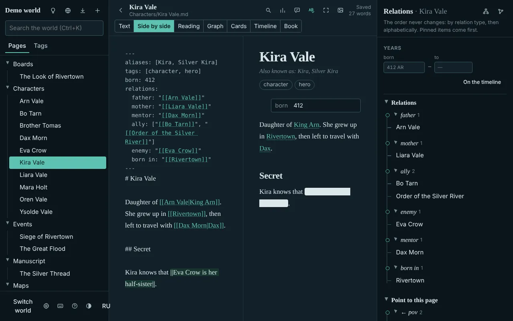

Every page is a Markdown file. Write `[[Page name]]` to link to another page; links to pages that do
not exist yet are shown in red, and clicking one offers to create the page. In the editor, type `[[`
for suggestions and **Ctrl+click** a link to follow it.

- **Text**, **Side by side** and **Reading** at the top switch between writing and reading.
- The header at the top of a page (between `---` lines) holds facts such as `born: 412`; they show
  in a box next to the text.
- `||secret||` is a spoiler, hidden until clicked.
- **+** at the top of the sidebar makes a new page; the sidebar shows folders and tags.

## Relations panel
<!-- guide: relations | feature: relationsPanel | try: open:Characters/Kira Vale.md -->

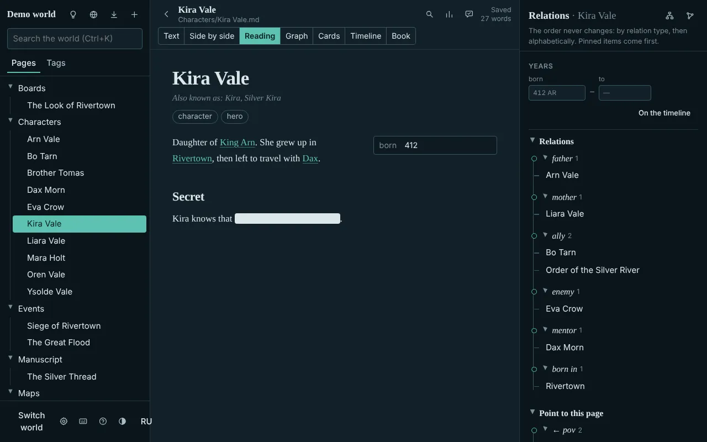

The panel on the right shows how the open page is connected: its own relations, pages that link to
it, and mentions. Groups always keep the same order, so you learn where to look.

- **Add a relation** at the bottom: a type (`father`, `ally`, `born in`…) and a page. It is written to
  the page header under `relations:`.
- Relations work both ways: when Kira's `father` is Arn, Arn's page lists her too, under the reverse
  name the world gives that relation (*children* in the demo).
- ⭐ pins a relation to the top of its group.

## Previews and quick look-up
<!-- guide: lookup | feature: quickLookup | try: lookup -->

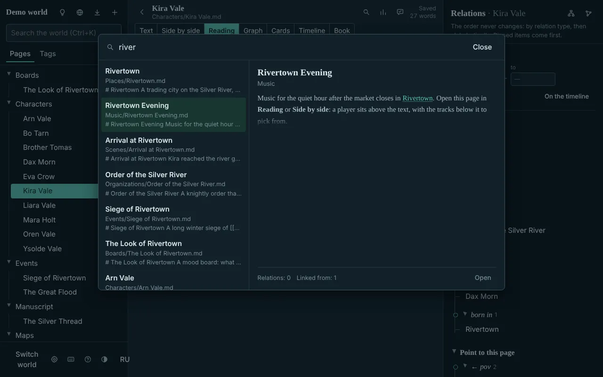

Point at any link to see the opening of that page in a small card, without leaving where you are.

**Ctrl+K** opens the quick look-up over whatever you are looking at. Type a few letters, move with the
arrow keys and see each page previewed next to the list. **Enter** opens it; **Esc** takes you back
exactly where you were.

## Graph
<!-- guide: graph | feature: graph | try: mode:graph -->

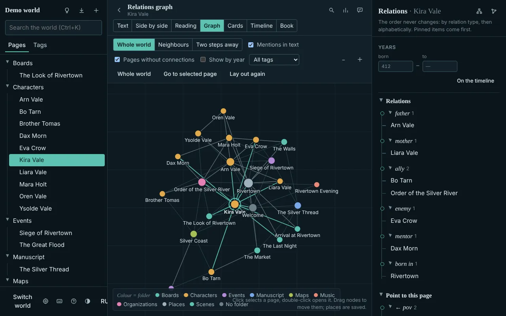

**Graph** shows the whole world as a map of connections. Pages keep their places between visits, and
each folder has its own colour. Drag a page to move it, scroll to zoom, and click a page to select it
and see its relations. **Lay out again** starts the arrangement afresh.

## Cards
<!-- guide: cards | feature: cards | try: mode:cards -->

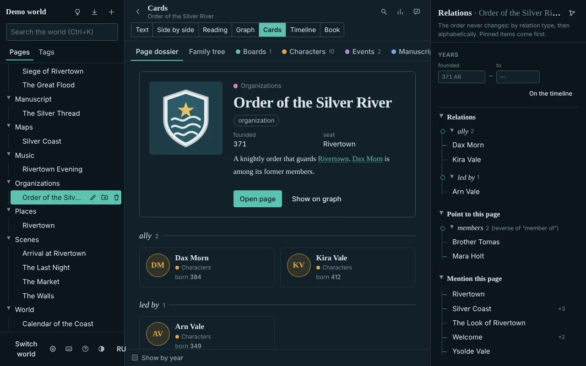

**Cards** lets you browse the world folder by folder, like a card index. Open a card for its
**dossier**: the picture, the facts from the header, the opening of the text and everyone connected,
grouped by relation.

## Family trees
<!-- guide: family | feature: family | try: family -->

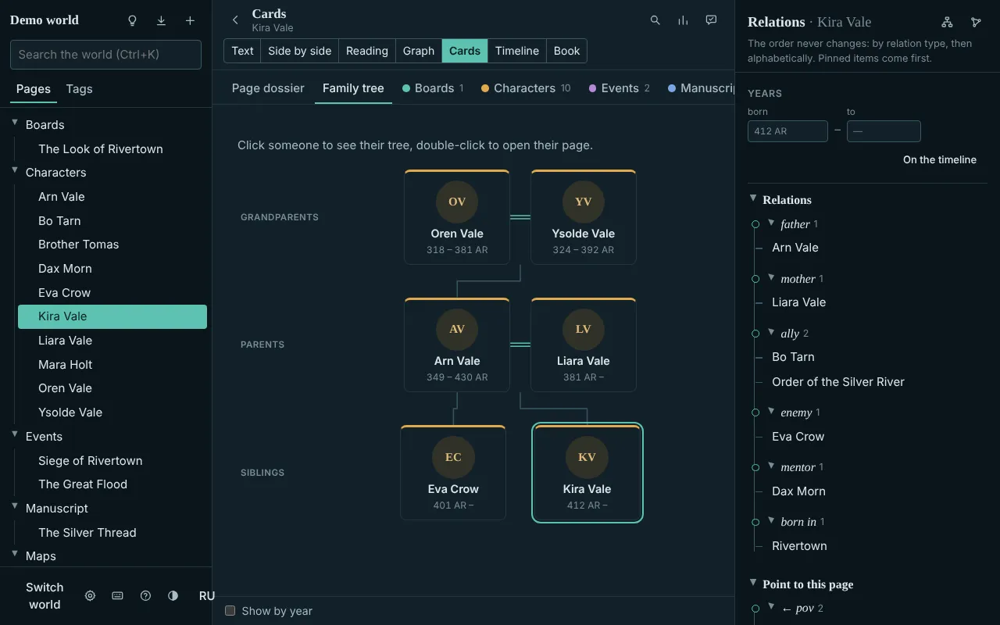

The **Family tree** tab in Cards draws a family from relations such as `father`, `mother`, `spouse`,
`son`, `daughter`, `brother` and `sister` (in English or Russian). Click a person to show their tree,
double-click to open their page.

## Maps
<!-- guide: maps | feature: maps | try: open:Maps/Silver Coast.md -->

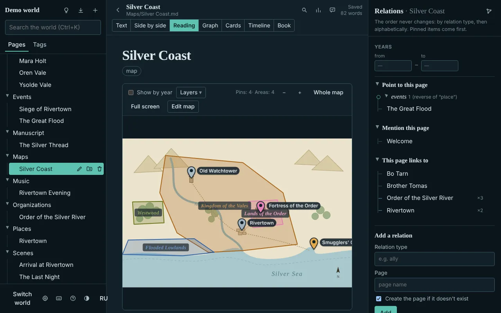

Give a page a picture of a map and it becomes an **interactive map**: pin places and people on it,
draw areas, and keep separate layers. Each pin can link to a page. Pins and areas can have years, so
**Show by year** shows the map as it was in a given year.

## Timeline and years
<!-- guide: timeline | feature: timeline | try: mode:timeline -->

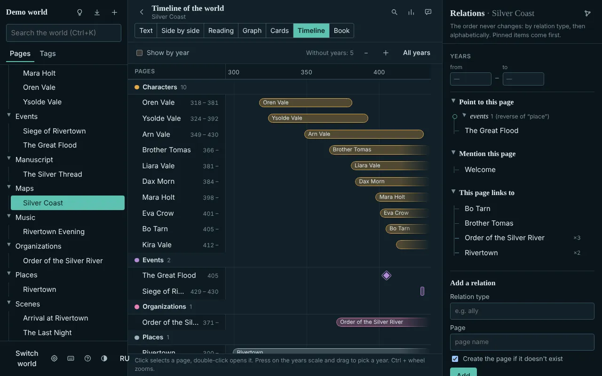

**Timeline** shows who lived when and what happened. A page gets its years from `born:`/`died:`,
`founded:`, `year:` or `from:`/`to:` in its header, or from the **Years** fields in the panel.

Press on the years scale and drag to choose a year: the graph, cards and maps then show the world as
it was in that year.

## Calendars
<!-- guide: calendar | feature: years | try: open:World/Calendar of the Coast.md -->

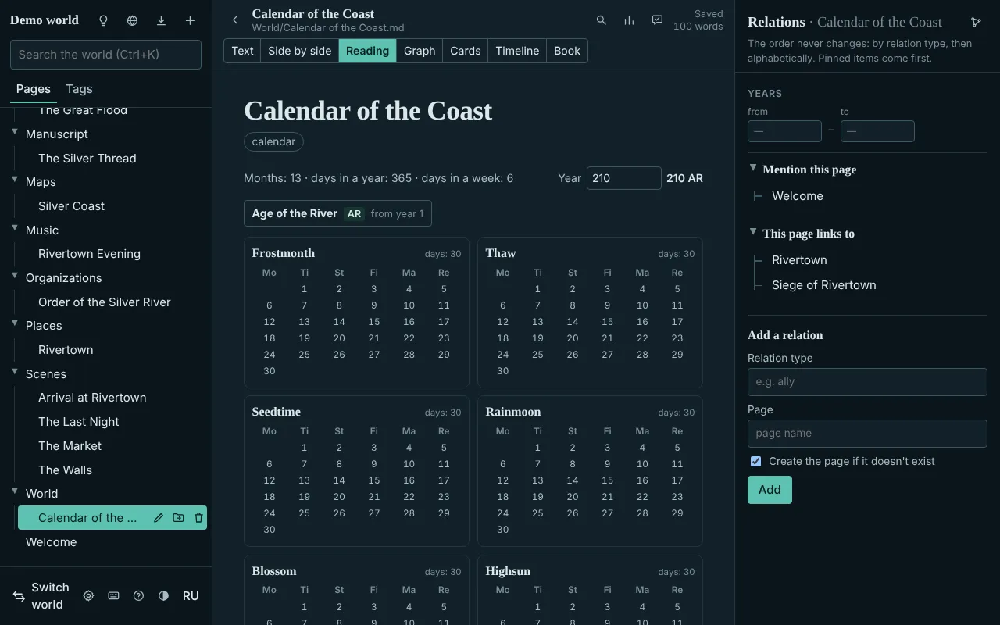

A world can count time its own way. Make a page with the **Calendar** template (or write
`calendar: true` in a page header) and list the months with their days, the days of the week and the
eras. The world uses its first calendar page.

Dates can then have months and days: `born: 3 Frostmonth 412`, `years: 28 Leaffall 429 – Thaw 430`,
`founded: 412-01-03`. With eras, years show as `412 AR`, and `112 SA` or `Year 112 of the Second
Age` can be written too. The timeline places such dates inside their year and names the months when
you zoom in far enough. Without a calendar page, the common twelve months work the same way.

## Writing a book
<!-- guide: book | feature: manuscript | try: mode:book -->

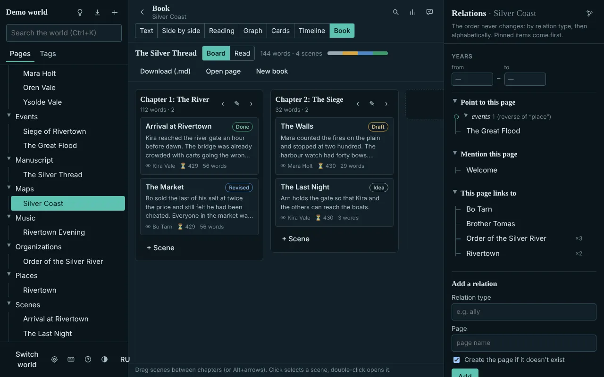

**Book** turns a page with `manuscript: true` into a board: chapters are columns, scenes are cards.
Drag scenes to reorder them, give them a status (idea, draft, revised, done), and read the whole
book straight through. **Download** makes one Markdown file of the book.

## Templates and story projects
<!-- guide: projects | try: newPage -->

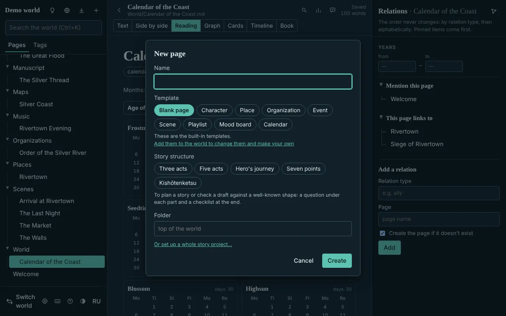

**+ New page** offers templates: Character, Place, Organization, Event, Scene, Playlist, Mood board, Calendar,
and **story structures** (three acts, five acts, the hero's journey, seven points, kishōtenketsu).
A world can have its own templates too: **Add them to the world** copies them into a folder where you
change them and make new ones.

**New story project** makes a folder for a new story with eight folders inside: brainstorm, outline,
drafts, story bible, art, research, notes and a playlist.

## Editing: comments and suggested changes
<!-- guide: editing | feature: revision | try: open:Scenes/The Market.md+revision -->

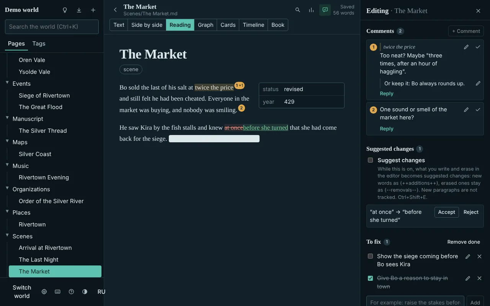

The speech-bubble button at the top opens the **Editing** panel, everything for the next pass:

- **Comments.** Select words and press **Ctrl+Alt+M** (or select them in Reading and press
  **Comment**). They are written into the text as `{==words==}{>>comment<<}`, so they stay with
  their words. **Reply** under a comment starts a thread; ✓ resolves it.
- **Suggest changes** (**Ctrl+Shift+E**): what you type becomes `{++added++}` and what you erase
  stays as `{--removed--}`. **Accept** or **Reject** each change, or all at once.
- **To fix**: a checklist for the page, and a list of every page in the world with open work.

Word counts, previews, the book and exports leave comments out.

## Versions
<!-- guide: versions | feature: versions | try: open:Scenes/The Market.md+revision -->

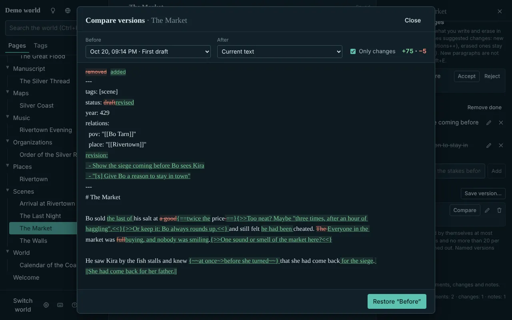

Before you edit a page, Exomyth keeps a copy of it by itself, at most once every 30 minutes and no
more than 20 per page (older ones are thinned out evenly). **Save version…** keeps a named copy for
good. **Compare** shows word by word what changed, and **Restore** brings a version back: the current
text is saved as a version first, so nothing is lost. Versions are plain files in `.exomyth/versions`.

## Mood boards
<!-- guide: boards | feature: moodBoards | try: open:Boards/The Look of Rivertown.md -->

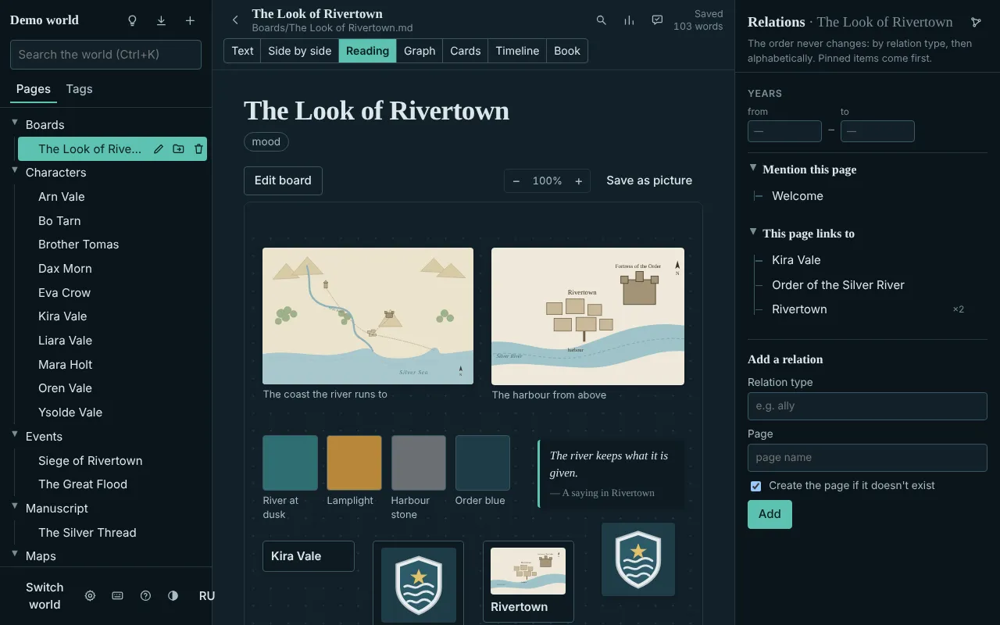

A page with `moodboard: true` is a free board: pictures, colours, quotes, notes and cards of other
pages. **Edit board** adds them; drag to move (edges line up with their neighbours), pull a corner to
resize, **Shift** on a picture's corner crops it. Zoom with **−** and **+**, and **Save as picture**
makes one PNG of the whole board.

## Playlists
<!-- guide: playlists | feature: playlists | try: open:Music/Rivertown Evening.md -->

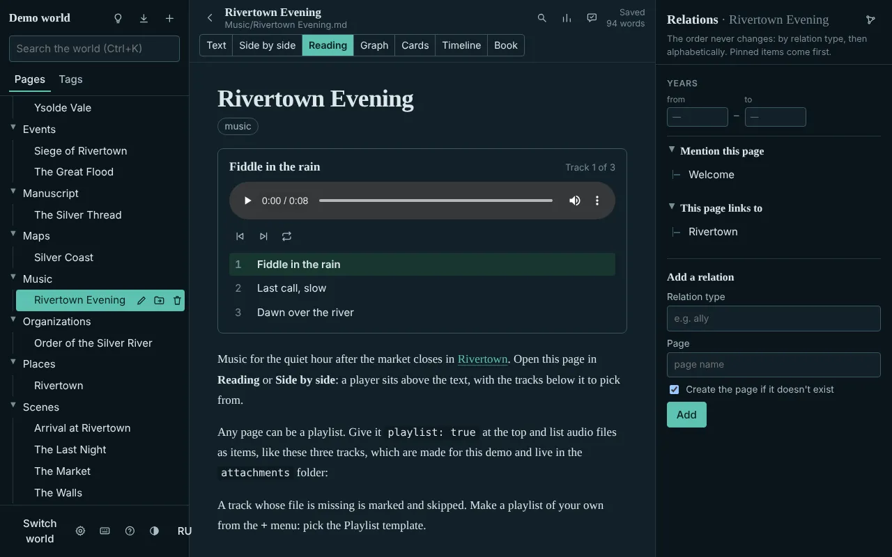

A page with `playlist: true` and a list of audio files becomes a player: the tracks play in order,
with skip, repeat, volume and a list to choose from. Good for a scene's music or a game session.

The music **keeps playing** when you open other pages: a small player in the corner pauses it, skips
tracks, stops it, and takes you back to the playlist. (Settings → **Music keeps playing** makes it
stop when you leave the page instead.)

## Pictures, video and sound
<!-- guide: media | try: open:Places/Rivertown.md -->

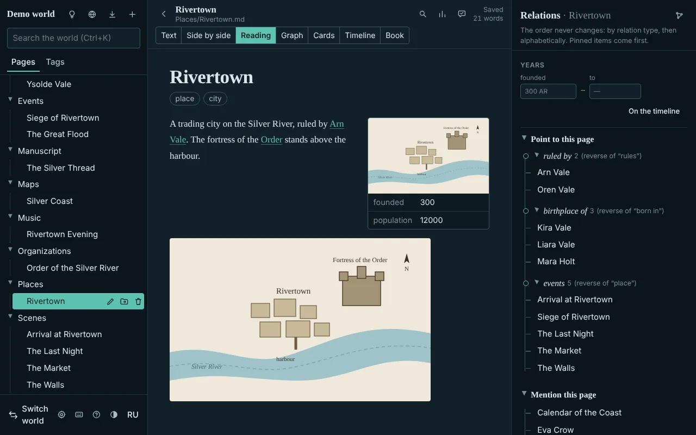

Drop a picture, a video or a sound into the editor, paste a screenshot, or use the picture button in
the top bar. The file is saved into the world's `attachments` folder and shown with `![[file name]]`;
`![[map.png|400]]` sets a width. An `image:` in the header becomes the page's picture on its card.

## Writing helpers
<!-- guide: writing | feature: focusMode | try: focus -->

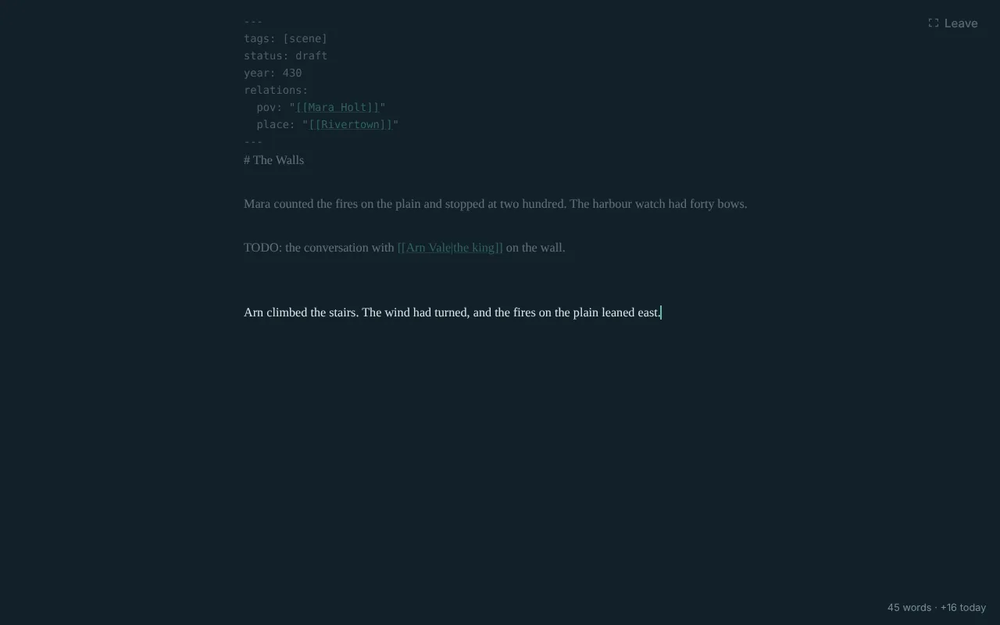

- **Focus mode** (**Ctrl+.**) hides everything but the text; with **typewriter scrolling** the line
  you write stays in the middle.
- **Word count** of the page in the top bar; point at it for the whole world.
- **Quick notes**: **Alt+I** anywhere writes an idea to an Inbox page with the date.
- **Spell check** uses your browser's own dictionaries, offline; **ABC** in the top bar turns it off.

## Writing stats
<!-- guide: stats | feature: writingStats | try: stats -->

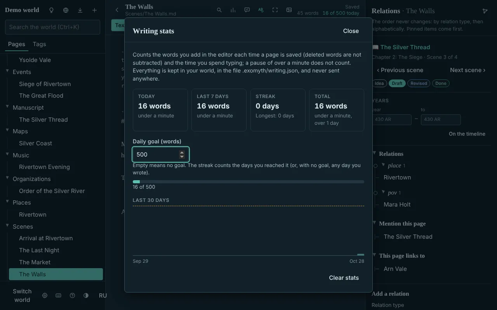

The chart button at the top shows the words you added and the time you spent writing, today and in
the last 7 days, your streak of days, and the last 30 days as a chart. Set a **daily goal** and the
top bar shows how far you are. The numbers are kept in your world, never sent anywhere.

## A site for readers
<!-- guide: site | feature: siteExport | try: site -->

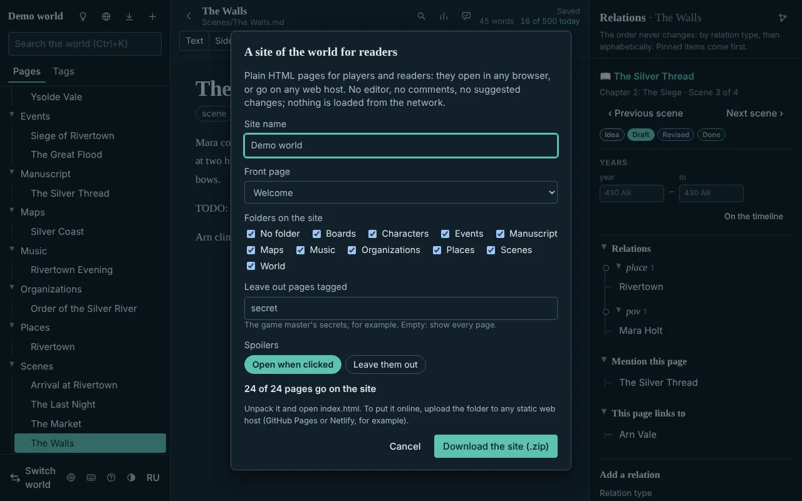

The globe button at the top of the sidebar makes the world into a **static site**: plain HTML pages
for players and readers, without the editor. Every page keeps its links, facts, pictures and
relations; maps keep their pins, playlists play, and a book can be read straight through.

- Untick the **folders** that are only for you, and give private pages a tag (`secret` by default)
  to leave them out. Links to pages that are left out become plain words, and their names show
  nowhere else on the site.
- **Spoilers** open when clicked, or are left out.
- Comments and suggested changes never go on the site.

Unpack the .zip and open `index.html`, or upload the folder to any static web host. The site loads
nothing from the network.

## Settings and profiles
<!-- guide: settings | try: settings -->

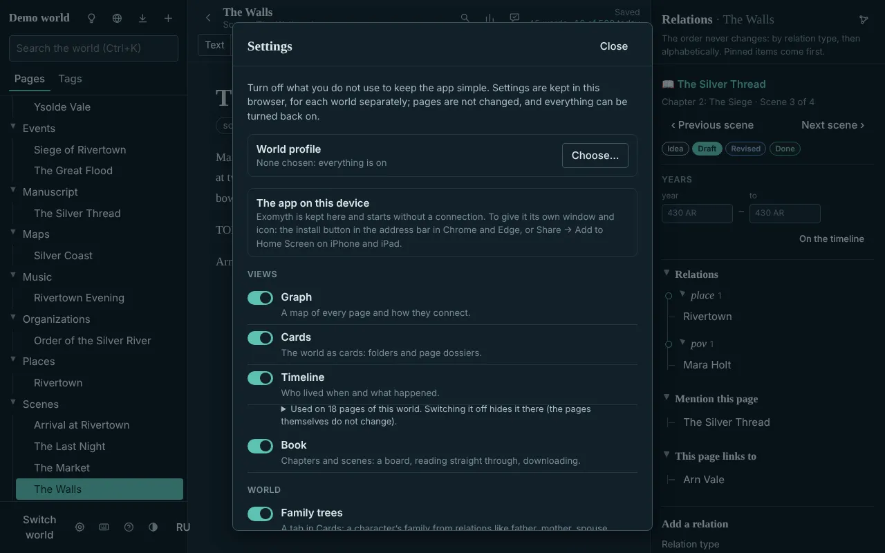

The gear at the bottom of the sidebar (**Ctrl+,**) opens Settings. Switch off any part you do not
use and the app gets simpler; under each switch you see which pages use that part. A **profile**
(Writer, Worldbuilder, Game master, Just notes, Everything) switches a whole set at once. Theme and
language are here too.

## Backups and keyboard shortcuts
<!-- guide: shortcuts | try: shortcuts -->

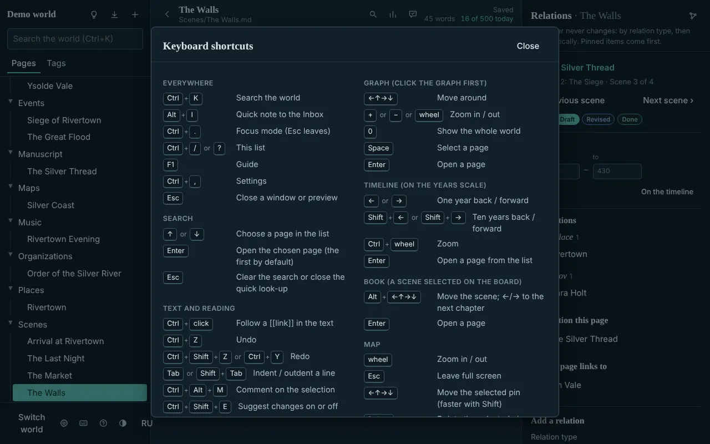

The arrow button at the top of the sidebar downloads the whole world as one **.zip**: a backup, or a
way to move the world to another computer (**Open a world from a .zip** on the start screen). Deleted
pages go to a `.trash` folder inside the world and are never erased.

**Ctrl+/** (or **?** outside a text field) lists every keyboard shortcut. On a Mac, use ⌘ instead of
Ctrl and ⌥ instead of Alt.
