# Справка Exomyth

Короткий обзор всего, что умеет Exomyth, по одной теме за раз. Та же справка открывается в самом
приложении: кнопка **?** внизу боковой панели (или **«Справка»** на стартовом экране). На картинках —
демо-мир в тёмной теме. [English version](GUIDE.md)

У каждой темы в приложении есть кнопка **«Попробовать»**: она открывает нужное место в вашем мире.

<!-- Приложение читает этот файл: каждый раздел «##» — тема. Комментарий под заголовком говорит, какая
     это тема, к какой части Настроек она относится (feature) и что делает «Попробовать» (try).
     Сохраняйте порядок и комментарии; слова меняйте свободно. -->

## С чего начать
<!-- guide: start -->

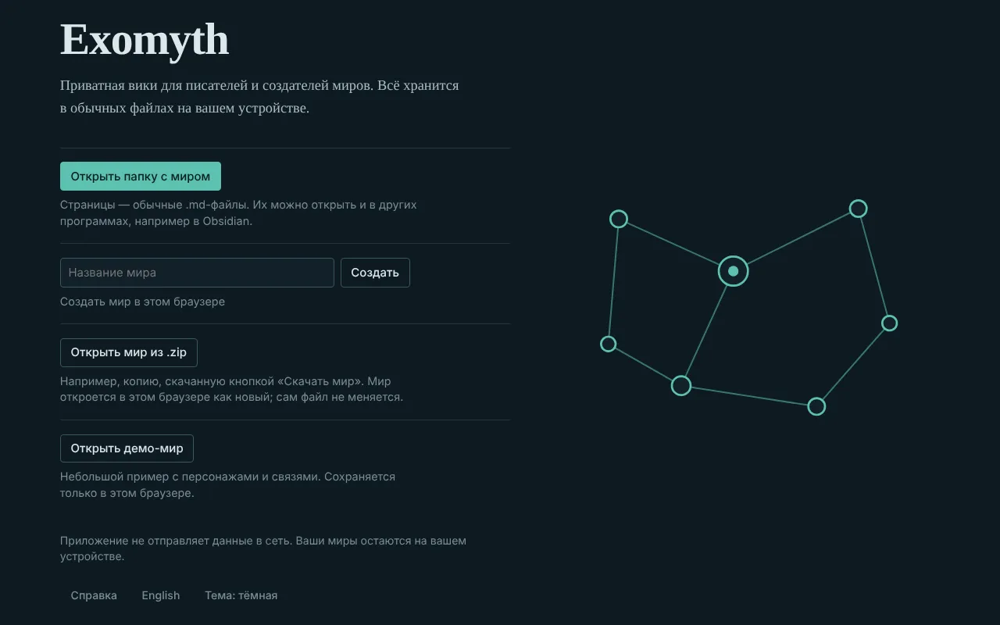

**Мир** — это папка обычных страниц Markdown: одна история, один сеттинг, одна кампания. На
стартовом экране можно:

- **Открыть папку** на компьютере (Chrome, Edge и другие браузеры с доступом к папкам). Exomyth
  читает и пишет файлы прямо там, и их откроет любой другой редактор Markdown.
- **Создать мир в браузере**, если папки недоступны (Firefox, Safari, телефоны). Он хранится только в
  этом браузере; время от времени скачивайте его в .zip.
- **Открыть демо-мир**, чтобы осмотреться: все картинки этой справки — из него.

Ничего никуда не отправляется: ни аккаунтов, ни серверов.

Когда вы впервые открываете мир, короткий тур показывает главные части экрана. **«Показать тур»**
вверху этой справки проводит его ещё раз.

## Страницы и ссылки
<!-- guide: pages | try: mode:split -->

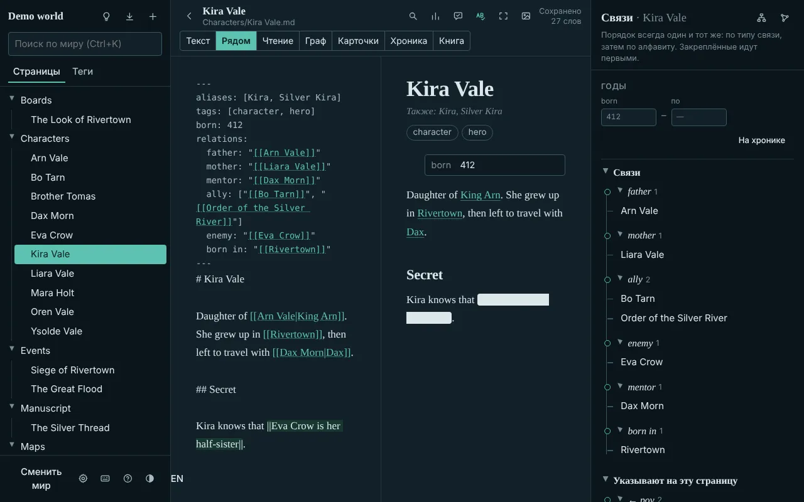

Каждая страница — файл Markdown. Напишите `[[Название страницы]]`, чтобы сослаться на другую;
ссылки на ещё не созданные страницы красные, а клик по такой предложит её создать. В редакторе
наберите `[[`, чтобы увидеть подсказки, а **Ctrl+клик** по ссылке переходит по ней.

- **«Текст»**, **«Рядом»** и **«Чтение»** вверху переключают между письмом и чтением.
- В шапке страницы (между строками `---`) хранятся факты вроде `born: 412`; они видны в рамке
  рядом с текстом.
- `||секрет||` — спойлер, скрытый до клика.
- **+** вверху боковой панели создаёт страницу; в боковой панели — папки и теги.

## Панель связей
<!-- guide: relations | feature: relationsPanel | try: open:Characters/Kira Vale.md -->

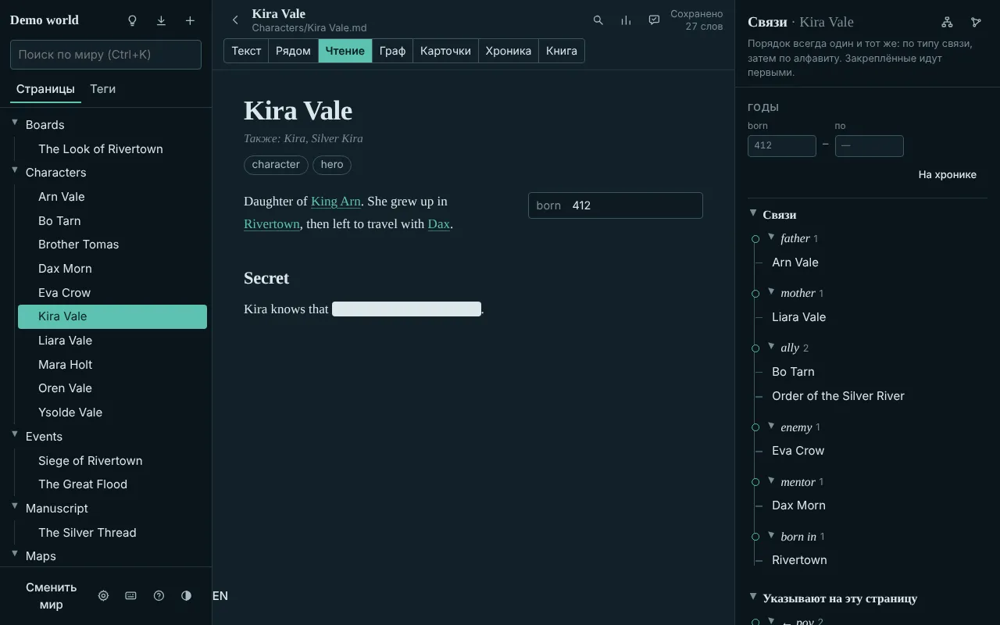

Панель справа показывает, как связана открытая страница: её собственные связи, страницы, которые на
неё ссылаются, и упоминания. Группы всегда стоят в одном порядке, так что быстро привыкаешь, где что.

- **«Добавить связь»** внизу: тип (`отец`, `союзник`, `родилась в`…) и страница. Связь записывается в
  шапку страницы в раздел `relations:`.
- Связи работают в обе стороны: если у Киры `father` — Арн, на странице Арна она тоже видна, под
  обратным названием, которое мир даёт этой связи (в демо — *children*).
- ⭐ закрепляет связь первой в её группе.

## Предпросмотр и быстрый поиск
<!-- guide: lookup | feature: quickLookup | try: lookup -->

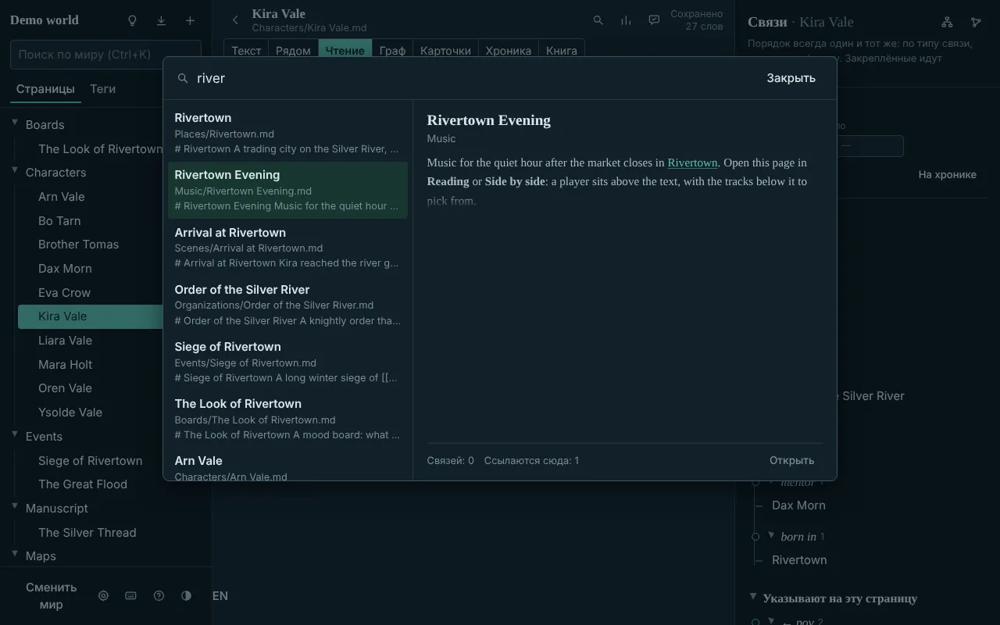

Наведите на любую ссылку — в маленькой карточке появится начало той страницы, и уходить никуда не
нужно.

**Ctrl+K** открывает быстрый поиск поверх того, что вы сейчас смотрите. Наберите пару букв, двигайтесь
стрелками — рядом со списком видна выбранная страница. **Enter** открывает её; **Esc** возвращает
ровно туда, где вы были.

## Граф
<!-- guide: graph | feature: graph | try: mode:graph -->

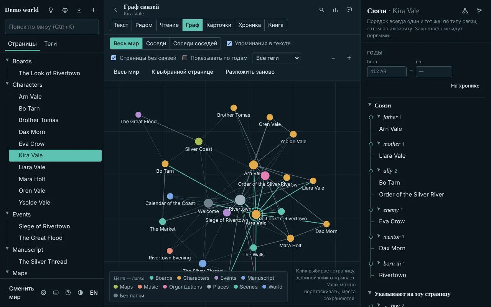

**«Граф»** показывает весь мир картой связей. Страницы остаются на своих местах между визитами, у
каждой папки свой цвет. Тяните страницу, чтобы передвинуть, колесо меняет масштаб, клик выбирает
страницу и показывает её связи. **«Разложить заново»** расставляет всё с нуля.

## Карточки
<!-- guide: cards | feature: cards | try: mode:cards -->

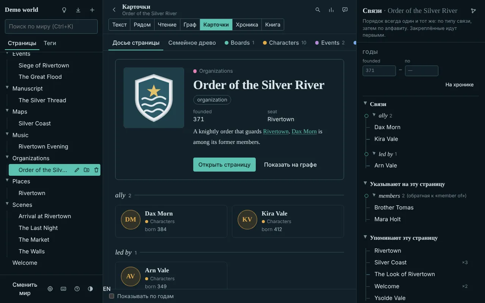

**«Карточки»** — мир по папкам, как картотека. Откройте карточку, чтобы увидеть **досье**: картинку,
факты из шапки, начало текста и всех, кто связан, по группам связей.

## Семейное древо
<!-- guide: family | feature: family | try: family -->

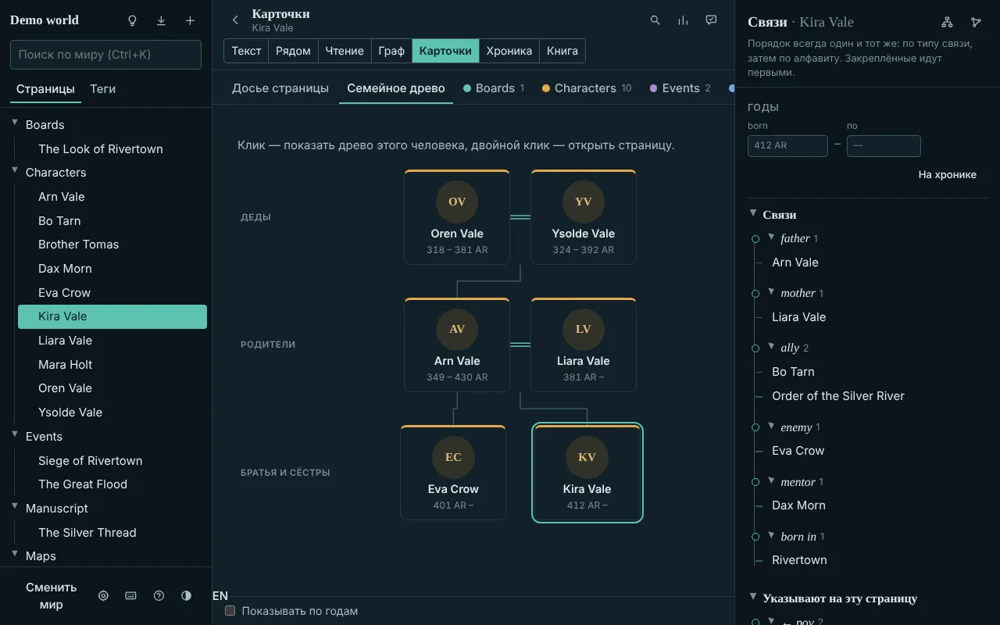

Вкладка **«Семейное древо»** в Карточках рисует семью из связей «отец», «мать», «супруг», «сын»,
«дочь», «брат», «сестра» (по-русски или по-английски). Клик по человеку показывает его древо, двойной
клик открывает его страницу.

## Карты
<!-- guide: maps | feature: maps | try: open:Maps/Silver Coast.md -->

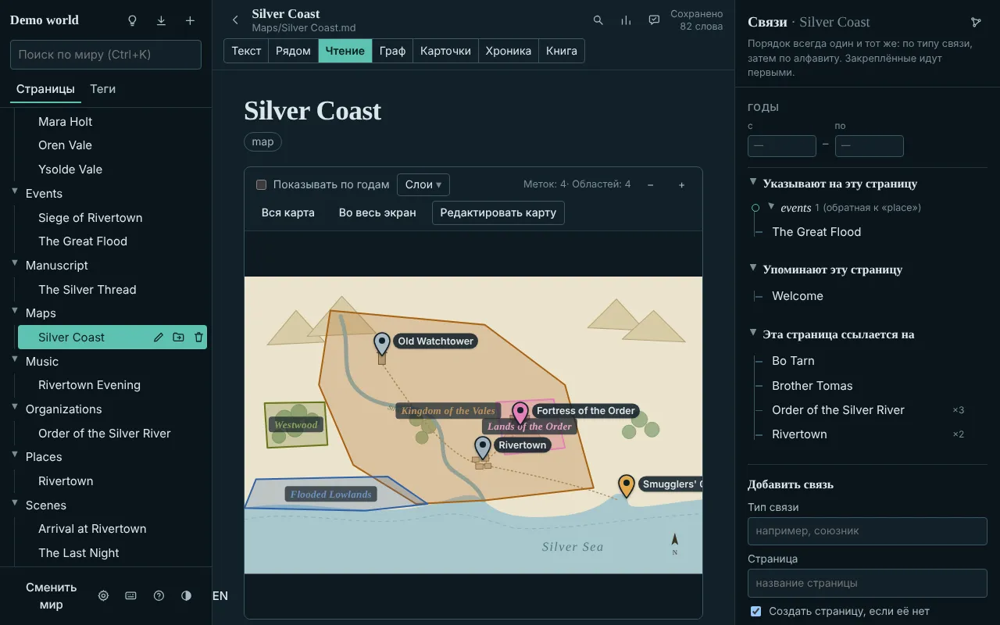

Дайте странице картинку карты — и она станет **интерактивной картой**: ставьте на неё метки мест и
людей, рисуйте области, раскладывайте их по слоям. Каждая метка может вести на страницу. У меток и
областей бывают годы, и **«Показывать по годам»** показывает карту такой, какой она была в нужный год.

## Хроника и годы
<!-- guide: timeline | feature: timeline | try: mode:timeline -->

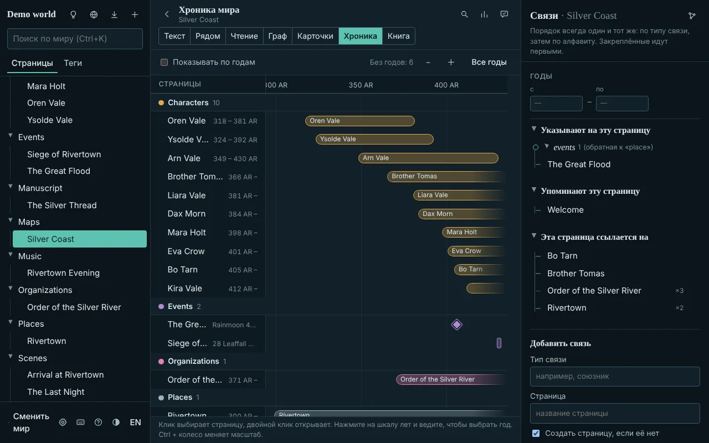

**«Хроника»** показывает, кто когда жил и что случилось. Годы страница берёт из `born:`/`died:`,
`founded:`, `year:` или `from:`/`to:` в шапке либо из полей **«Годы»** на панели справа.

Нажмите на шкалу лет и тяните, чтобы выбрать год: граф, карточки и карты покажут мир таким, каким он
был в тот год.

## Календари
<!-- guide: calendar | feature: years | try: open:World/Calendar of the Coast.md -->

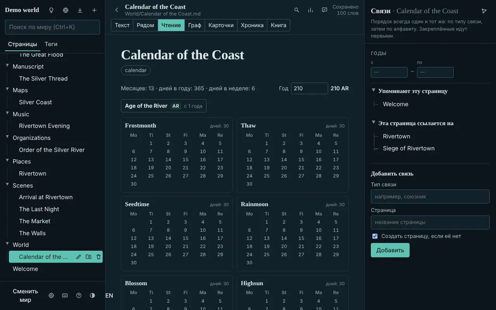

Мир может считать время по-своему. Создайте страницу по шаблону **«Календарь»** (или напишите
`calendar: true` в шапке страницы) и перечислите месяцы с числом дней, дни недели и эпохи. Мир берёт
первую страницу-календарь.

Тогда у дат могут быть месяцы и дни: `born: 3 Frostmonth 412`, `years: 28 Leaffall 429 – Thaw 430`,
`founded: 412-01-03`. С эпохами годы видны как `412 AR`, а писать можно и `112 SA` или `Year 112 of
the Second Age`. Хроника ставит такие даты внутри года и подписывает месяцы, если приблизить её
достаточно сильно. Без страницы-календаря так же работают обычные двенадцать месяцев (`5 марта 412`).

## Пишем книгу
<!-- guide: book | feature: manuscript | try: mode:book -->

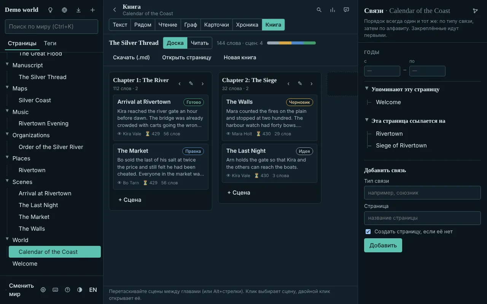

**«Книга»** превращает страницу с `manuscript: true` в доску: главы — колонки, сцены — карточки.
Перетаскивайте сцены, чтобы поменять порядок, ставьте им статус (идея, черновик, правка,
готово) и читайте всю книгу подряд. **«Скачать (.md)»** собирает книгу в один файл Markdown.

## Шаблоны и проекты историй
<!-- guide: projects | try: newPage -->

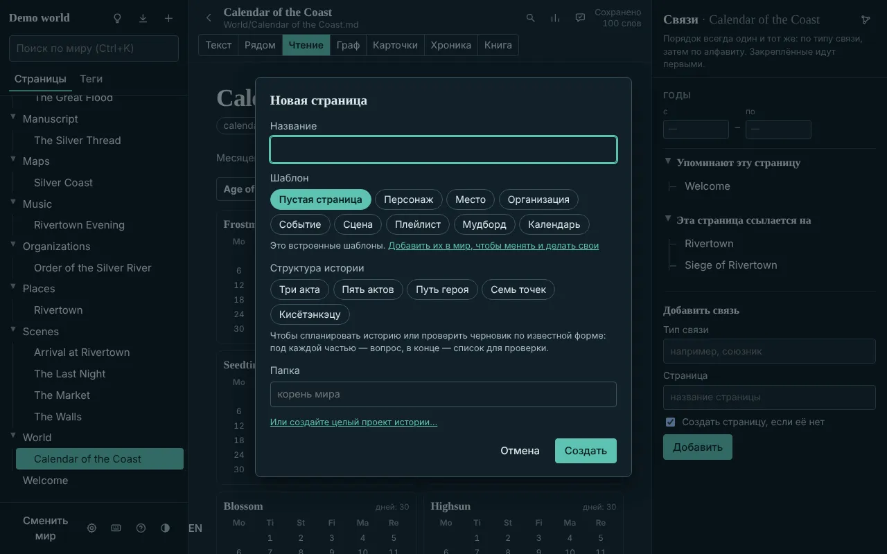

**«+ Новая страница»** предлагает шаблоны: Персонаж, Место, Организация, Событие, Сцена, Плейлист,
Мудборд, Календарь и **структуры историй** (три акта, пять актов, путь героя, семь точек, кисётэнкэцу). У мира
могут быть и свои шаблоны: **«Добавить их в мир»** копирует их в папку, где их можно менять и
добавлять новые.

**«Новый проект истории»** создаёт папку для новой истории и восемь папок в ней: мозговой штурм,
план, черновики, библия истории, арт, исследования, заметки и плейлист.

## Правка: комментарии и предложенные правки
<!-- guide: editing | feature: revision | try: open:Scenes/The Market.md+revision -->

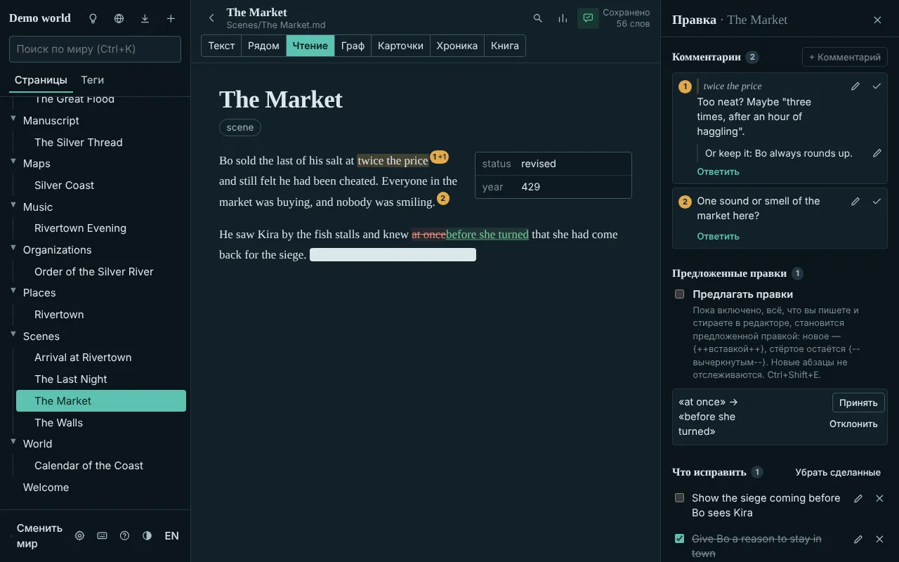

Кнопка с облачком вверху открывает панель **«Правка»** — всё для следующего прохода по тексту:

- **Комментарии.** Выделите слова и нажмите **Ctrl+Alt+M** (или выделите их в режиме «Чтение» и
  нажмите **«Комментарий»**). Они записываются прямо в текст как `{==слова==}{>>комментарий<<}` и не
  теряются при правках. **«Ответить»** под комментарием начинает обсуждение; ✓ закрывает его.
- **«Предлагать правки»** (**Ctrl+Shift+E**): то, что вы пишете, становится `{++вставкой++}`, а
  стёртое остаётся `{--вычеркнутым--}`. **«Принять»** или **«Отклонить»** — по одной или все сразу.
- **«Что исправить»**: список дел по странице и список всех страниц мира, где осталась работа.

Счётчик слов, предпросмотр, книга и экспорт не учитывают комментарии.

## Версии
<!-- guide: versions | feature: versions | try: open:Scenes/The Market.md+revision -->

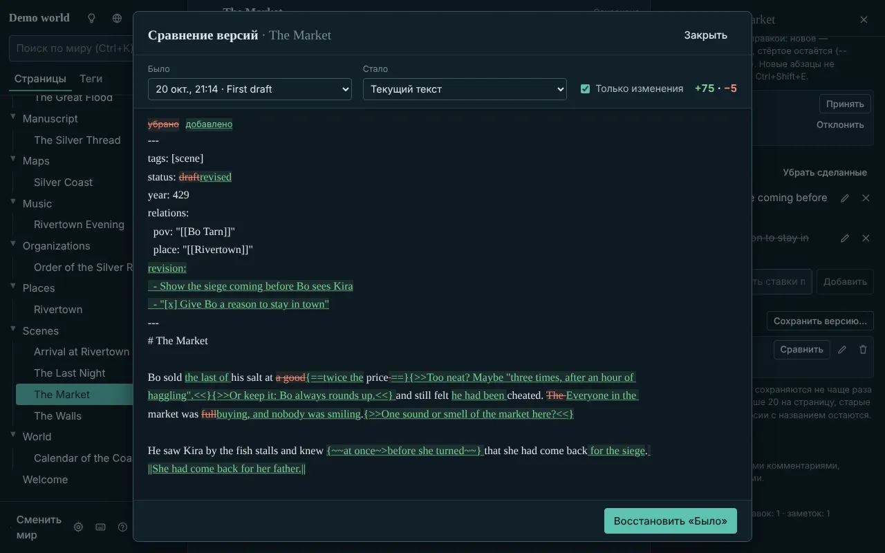

Перед правкой Exomyth сам сохраняет копию страницы — не чаще раза в 30 минут и не больше 20 на
страницу (старые прореживаются равномерно). **«Сохранить версию…»** оставляет копию с названием
навсегда. **«Сравнить»** показывает по словам, что изменилось, а **«Восстановить»** возвращает
версию: текущий текст сначала сохраняется как версия, так что ничего не теряется. Версии — обычные
файлы в `.exomyth/versions`.

## Мудборды
<!-- guide: boards | feature: moodBoards | try: open:Boards/The Look of Rivertown.md -->

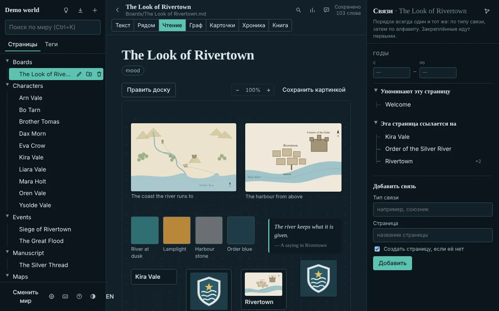

Страница с `moodboard: true` — свободная доска: картинки, цвета, цитаты, заметки и карточки других
страниц. **«Править доску»** добавляет их; тяните, чтобы передвинуть (края прилипают к соседям),
угол меняет размер, **Shift** на углу картинки обрезает её. **−** и **+** меняют масштаб, а
**«Сохранить картинкой»** делает один PNG всей доски.

## Плейлисты
<!-- guide: playlists | feature: playlists | try: open:Music/Rivertown Evening.md -->

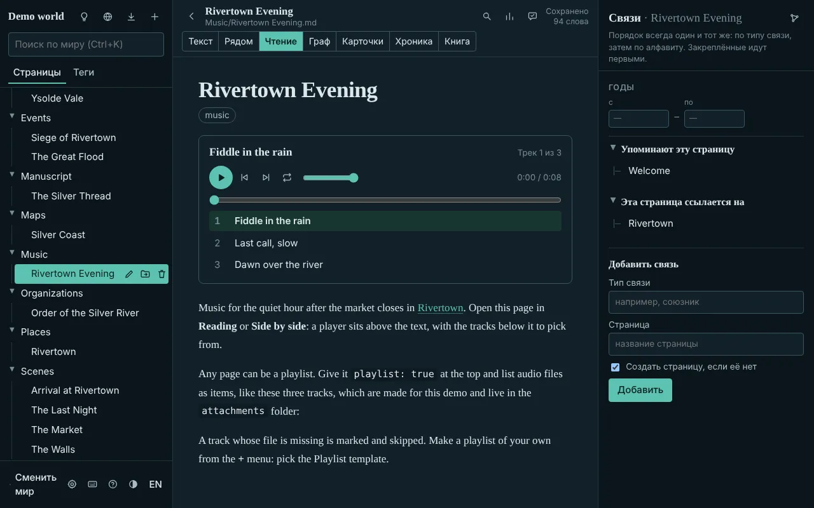

Страница с `playlist: true` и списком аудиофайлов становится плеером: треки играют по порядку, есть
переключение, повтор, громкость и список. Подходит для музыки к сцене или к игровой сессии.

Музыка **не останавливается**, когда вы открываете другие страницы: маленький плеер в углу ставит её
на паузу, переключает треки, останавливает и возвращает к плейлисту. (Настройки → **«Музыка не
останавливается»** — выключите, чтобы музыка останавливалась при уходе со страницы.)

## Картинки, видео и звук
<!-- guide: media | try: open:Places/Rivertown.md -->

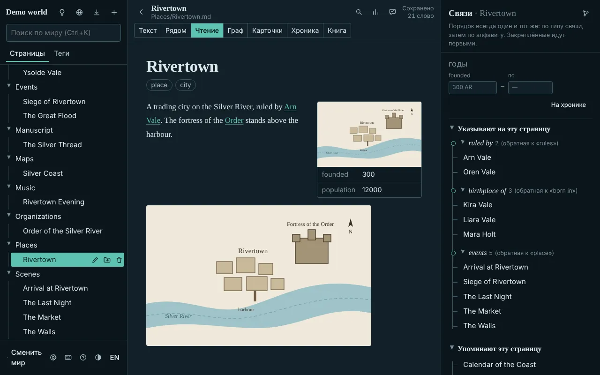

Перетащите картинку, видео или звук в редактор, вставьте скриншот или нажмите кнопку с картинкой
вверху. Файл сохраняется в папку мира `attachments` и показывается строкой `![[название файла]]`;
`![[карта.png|400]]` задаёт ширину. `image:` в шапке становится картинкой страницы на её карточке.

## Помощь в работе над текстом
<!-- guide: writing | feature: focusMode | try: focus -->

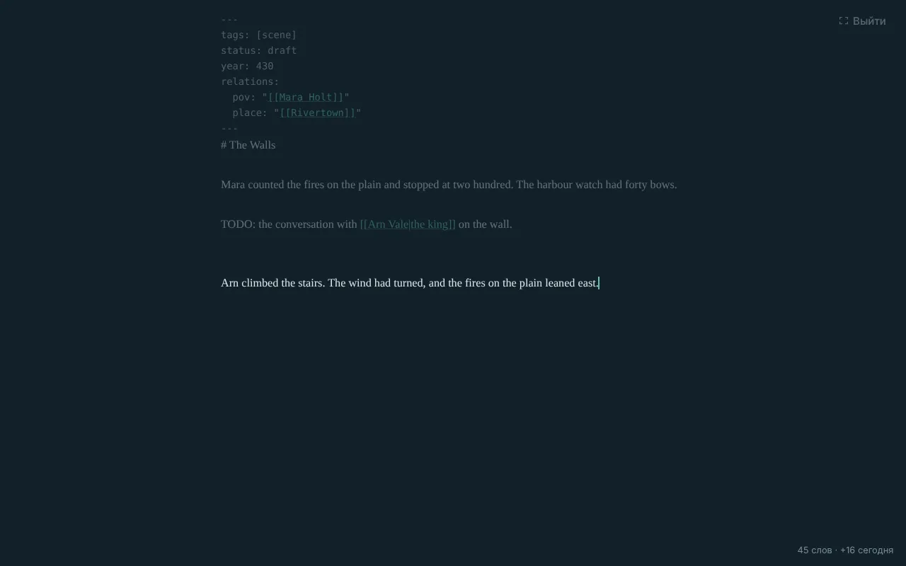

- **Режим без отвлечений** (**Ctrl+.**) прячет всё, кроме текста; с **прокруткой как у печатной
  машинки** строка, которую вы пишете, остаётся посередине.
- **Счётчик слов** страницы вверху; наведите на него — увидите весь мир.
- **Быстрые заметки**: **Alt+I** где угодно записывает идею на страницу «Идеи» с датой.
- **Проверка орфографии** берёт словари вашего браузера и работает без сети; **ABC** вверху её
  выключает.

## Статистика письма
<!-- guide: stats | feature: writingStats | try: stats -->

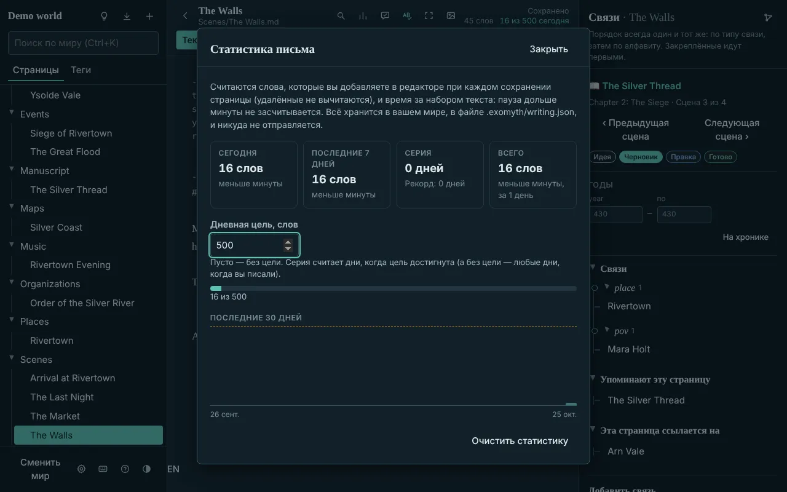

Кнопка с графиком вверху показывает, сколько слов вы добавили и сколько времени писали — сегодня и за
7 дней, серию дней подряд и последние 30 дней на графике. Поставьте **цель на день**, и верхняя
панель покажет, сколько осталось. Цифры хранятся в вашем мире и никуда не отправляются.

## Сайт для читателей
<!-- guide: site | feature: siteExport | try: site -->

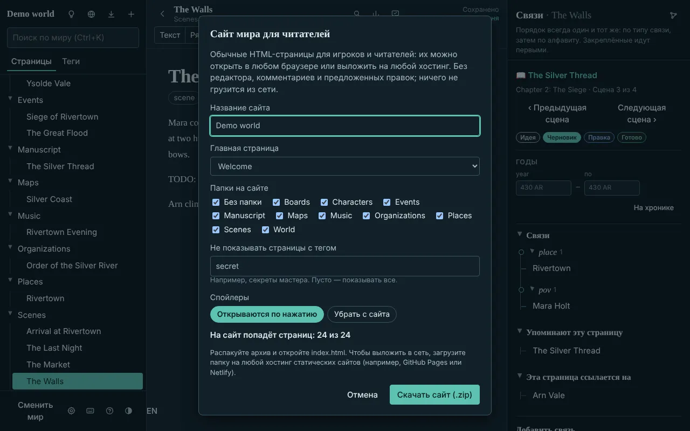

Кнопка с глобусом наверху боковой панели делает из мира **статичный сайт**: обычные HTML-страницы
для игроков и читателей, без редактора. Страницы сохраняют ссылки, факты, картинки и связи; карты —
свои метки, плейлисты играют, книгу можно прочитать целиком.

- Снимите галочки с **папок**, которые только для вас, а закрытым страницам дайте тег (по умолчанию
  `secret`), — их на сайте не будет. Ссылки на них станут обычным текстом, а их названия больше
  нигде на сайте не появятся.
- **Спойлеры** открываются по нажатию или убираются совсем.
- Комментарии и предложенные правки на сайт никогда не попадают.

Распакуйте .zip и откройте `index.html` или загрузите папку на любой хостинг статических сайтов.
Сайт ничего не грузит из сети.

## Настройки и профили
<!-- guide: settings | try: settings -->

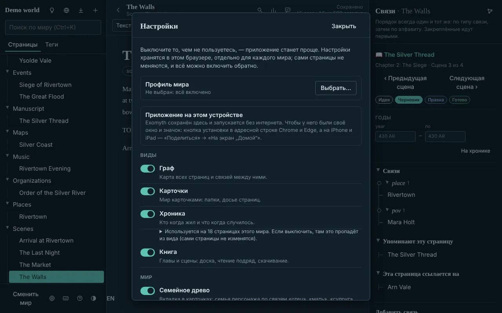

Шестерёнка внизу боковой панели (**Ctrl+,**) открывает Настройки. Выключите то, чем не пользуетесь,
и приложение станет проще; под каждым переключателем видно, какие страницы используют эту часть.
**Профиль** (Писатель, Создатель миров, Мастер игры, Просто заметки, Всё сразу) переключает целый
набор сразу. Там же тема и язык.

## Резервные копии и горячие клавиши
<!-- guide: shortcuts | try: shortcuts -->

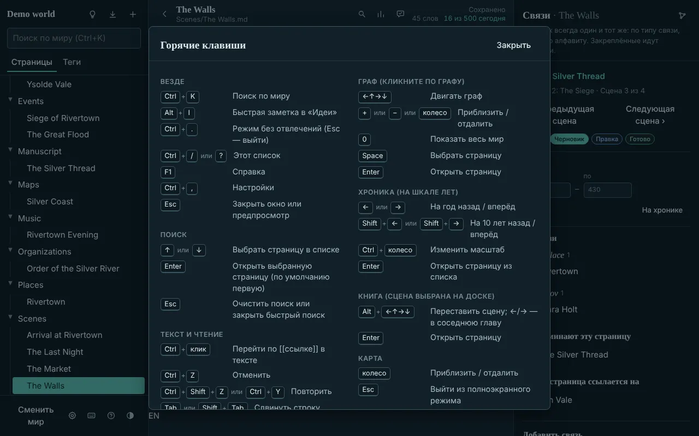

Кнопка со стрелкой вверху боковой панели скачивает весь мир одним **.zip** — это резервная копия
или способ перенести мир на другой компьютер (**«Открыть мир из .zip»** на стартовом экране).
Удалённые страницы уходят в папку `.trash` внутри мира и никогда не стираются насовсем.

**Ctrl+/** (или **?** вне текстового поля) показывает все горячие клавиши. На Mac вместо Ctrl — ⌘,
вместо Alt — ⌥.
